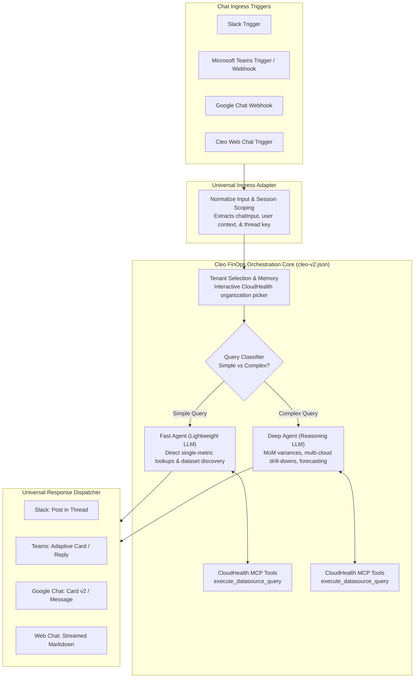

<h1> Cleo — Cloud Efficiency Optimizer <code>BETA</code></h1>

**Cleo** is your AI assistant for cloud cost intelligence. Ask questions about your AWS, Azure, and GCP spend in plain English and get live answers straight from CloudHealth — no dashboards, no SQL, no manual reports.

> *"What were my top 5 services by cost last month?"*  
> *"Which team spent the most in August?"*  
> *"Show me Azure spend trends for Q3."*

---

## 🚀 Quickstart: One-Click Launchers

Run Cleo immediately on your machine without manual configuration:

```bash
# 1. Clone the repository
git clone https://gitlab.com/digitalsuni/cleo.git
cd cleo

# 2. Start using the one-click launcher for your platform:
./run.sh              # macOS & Linux (or ./run)
run.bat               # Windows (Command Prompt or double-click)
.\run.ps1             # Windows PowerShell
```

Cleo's launcher automatically:
- Provisions an isolated virtual environment (`.venv/`) and installs dependencies
- Launches the local FastAPI server and FinOps intelligence engine
- Opens your browser to **http://127.0.0.1:8080**

---

## 🖥️ Build Your Own Desktop App (Tauri)

You can compile Cleo into a native standalone desktop application for macOS, Windows, or Linux using **Tauri 2**. The build scripts bundle both the desktop interface and the standalone Python backend sidecar so the app runs self-contained with zero runtime dependencies.

### Prerequisites
* **Node.js**: v18+ ([nodejs.org](https://nodejs.org/))
* **Rust**: Latest stable (`curl --proto '=https' --tlsv1.2 -sSf https://sh.rustup.rs | sh`)
* **Python**: 3.10+ with `pip` (used by PyInstaller to compile the backend sidecar)

### Build Commands

####  macOS (Apple Silicon / Intel)
```bash
./build-release.sh
```
* Produces: `release/Tauri/Cleo_<version>_arm64.dmg` (or x64) and `Cleo.app`
* *macOS Gatekeeper Note:* If macOS displays an unsigned app prompt on first run:
  ```bash
  xattr -rd com.apple.quarantine "/Applications/Cleo.app"
  ```

#### 🪟 Windows (x64)
```cmd
build-release.bat
```
* Produces: `release\Tauri\Cleo_<version>_x64.exe` (Portable executable, no installer needed)

#### 🐧 Linux (Ubuntu / Debian / Fedora)
Install system WebKit development headers first:
```bash
sudo apt update && sudo apt install -y \
  libwebkit2gtk-4.1-dev build-essential curl wget file \
  libxdo-dev libssl-dev libayatana-appindicator3-dev librsvg2-dev patchelf
```
Then run:
```bash
./build-release.sh
```
* Produces: `release/Tauri/Cleo_<version>_amd64.AppImage` and `Cleo_<version>_amd64.deb`

### Development Mode (with Live Reload)
To develop and run the desktop app locally with live hot-reloading:
```bash
npm install
npm run tauri:dev
```

---

## 💻 Developer & Server Setup (Optional)

If you are developing Cleo, deploying on a headless Linux server, or running in Docker:

### Option A — Manual Python Command

```bash
python3 -m venv .venv
source .venv/bin/activate       # On Windows: .venv\Scripts\activate
pip install -r requirements.txt
python3 cleo_server.py
```

---

## 🔐 Connecting CloudHealth (Authentication)

Cleo needs to connect to your CloudHealth account to access your billing data. This is a one-time setup.

### How to Authenticate

1. In the Cleo web interface, click the **"Connect CloudHealth"** button (top right, shown as a status pill).

2. Your browser will open the **CloudHealth login page**. Log in with your CloudHealth credentials.

3. After logging in, click **Approve** when CloudHealth asks for permission.

4. Cleo **automatically completes authorization** and connects in the background — no manual code copying or token pasting is required!

5. The status pill will turn **green** and show **"CloudHealth Connected"**.

### What Cleo Stores

| File | What's in it | Where | Security & Encryption |
|---|---|---|---|
| `~/.cleo/oauth_tokens.json` | Your CloudHealth access token (auto-refreshed) | Your home folder | **AES-256-GCM Encrypted** (`0600`) |
| `~/.cleo/config.json` | AI engine API keys (if you use cloud AI) | Your home folder | **AES-256-GCM Encrypted** (`0600`) |
| `~/.cleo/sessions.json` | Your chat history and conversation logs | Your home folder | **AES-256-GCM Encrypted** (`0600`) |
| `~/.cleo/mcp_oauth_tokens.json` | Additional MCP tool OAuth tokens | Your home folder | **AES-256-GCM Encrypted** (`0600`) |

Your token is automatically refreshed while Cleo is active. CloudHealth authorization tokens have a **24-hour validity period** — if your session expires after 24 hours of inactivity or token expiration, simply click the status pill in the UI to reconnect.

**To re-authenticate:** Click the **CloudHealth** status pill in the UI, or delete `~/.cleo/oauth_tokens.json` and reconnect.

---

## 🧠 Choosing an AI Engine

Cleo supports multiple AI engines, from 100% offline local inference with hardware acceleration to cloud AI and a built-in deterministic query router. You can switch engines at any time in the **Settings panel** (click the ⚙️ gear icon in the top right of the UI).

### Option A — Local AI (Free, 100% Private, Zero API Key)

Run state-of-the-art open-weights models entirely offline on your computer. All queries, prompts, and cloud cost data remain strictly on your machine with zero external network egress.

| Model | Runtime & Platform | Hardware Acceleration | RAM Needed | Speed & Recommendation |
|---|---|---|---|---|
| **Qwen3.5-9B-4bit** | **Apple Silicon Mac (MLX)** | Apple Metal Unified Memory | ~5.5 GB | **Fast · Recommended Default for Mac** |
| **Qwen3.5-4B-4bit** | **Apple Silicon Mac (MLX)** | Apple Metal Unified Memory | ~2.6 GB | **Very Fast · Ultra-lightweight** |
| **Qwen3.5-9B (GGUF)** | **Windows / Linux / Mac (Ollama)** | NVIDIA CUDA / AMD ROCm / DirectML / CPU AVX2 | ~5.5 GB | **Fast · Recommended for PCs & Linux** |
| **Qwen3.5-4B (GGUF)** | **Windows / Linux / Mac (Ollama)** | NVIDIA CUDA / AMD ROCm / DirectML / CPU AVX2 | ~2.6 GB | **Very Fast · Lightweight** |
| **Qwen2.5-7B-Instruct** | **Windows / Linux / Mac (Ollama)** | GPU / CPU Acceleration | ~4.7 GB | Fast · Proven FinOps reasoning |
| **Qwen2.5-3B-Instruct** | **Windows / Linux / Mac (Ollama)** | GPU / CPU Acceleration | ~1.9 GB | Very Fast · Minimal memory footprint |

* **Automatic Hardware Detection:** Cleo automatically inspects your operating system, CPU architecture, and total physical memory (RAM) at startup, displaying hardware badges and highlighting the optimal recommended model for your machine.
* **On Apple Silicon Mac (M1/M2/M3/M4):** Runs natively via **Apple MLX** using unified memory and Metal GPU cores. Click **Download** next to any model in Settings — Cleo streams the quantized model directly from Hugging Face with real-time download progress and speed meters.
* **On Windows, Linux, & Intel Mac:** Runs natively via **Ollama** with GPU acceleration (NVIDIA CUDA, AMD ROCm, DirectML) and AVX2 CPU fallback. Cleo connects to your local Ollama daemon (`http://localhost:11434`) and can automatically install, launch, and manage the Ollama service in the background if it is not already running. Click **Download** in the Settings UI to pull models directly.

### Option B — Direct FinOps Router (Instant, Zero Model Download, No GPU Needed)

If your computer has low RAM or you want instantaneous answers without downloading multi-gigabyte models, select the **Direct FinOps Router (Built-in)**:
* **Zero Model Overhead:** Requires 0 GB of model weights and no GPU acceleration.
* **Deterministic Intelligence:** Parses questions, executes CloudHealth MCP queries, aggregates multi-cloud spend data, computes period-over-period variances, and renders charts directly.
* **No API Key Required:** Completely free, offline, and works out of the box on any computer.

### Option C — Cloud AI (Requires API Key)

For cloud AI models with high context limits and reasoning power:

| Engine | Default Model | Where to get a key | Env Variable |
|---|---|---|---|
| **Google Gemini** | `gemini-3.5-flash` (Gemini Live streaming supported) | [aistudio.google.com](https://aistudio.google.com) | `GEMINI_API_KEY` |
| **OpenAI** | `gpt-4o` | [platform.openai.com](https://platform.openai.com) | `OPENAI_API_KEY` |
| **Anthropic Claude** | `claude-3-7-sonnet-latest` | [console.anthropic.com](https://console.anthropic.com) | `ANTHROPIC_API_KEY` |

**How to add your API key:**

* **Option 1 (Recommended):** Enter your key in the Cleo UI (Settings ⚙️ → **API Keys** tab). Cleo encrypts and saves it locally in `~/.cleo/config.json` via AES-256-GCM.
* **Option 2:** Set the environment variable in your terminal or create a `.env` file in the project folder:
  ```bash
  cp .env.example .env
  # Add your API key:
  GEMINI_API_KEY=AIza...
  ```

---

## 💬 Asking Questions

Once CloudHealth is connected, type any question in the chat box.

### Select Your Tenant First

On first use (or after `/reset`), Cleo will show you a list of tenants/organizations from your CloudHealth account. **Type the number** next to the tenant you want to query.

```
👋 Welcome to Cleo!

1. Example Enterprise  `crn:1001:organization/100000000001`
2. Production Workloads  `crn:1001:organization/100000000002`

Type a number to select:
```

### Example Questions

**Cost summaries:**
- *"What were my top 10 cloud services by cost last month?"*
- *"Show me total AWS spend for the last 3 months."*
- *"Compare August spend to July — what changed?"*

**By service or region:**
- *"How much did we spend on EC2 in us-east-1 this month?"*
- *"What is our Azure Virtual Machines spend trend?"*
- *"Break down GCP costs by service."*

**Forecasting:**
- *"What is our projected spend for September based on current usage?"*
- *"Compare last month's cost to this month's forecast."*

**Multi-cloud:**
- *"Show me AWS vs Azure spend side by side for Q3."*
- *"Which cloud provider cost us the most in 2026?"*

**Channel customers (for partners/resellers):**
- *"Which channel customers spent the most last month?"*
- *"List all active channel customers."*

### Special Commands

| Command | What it does |
|---|---|
| `/reset` | Switch to a different tenant / organization |
| `/teach <rule>` | Teach Cleo custom preferences or dataset rules saved directly to memory |

---

## 🐳 Optional: Docker Installation (Headless Servers / Containers)

The **Cleo Desktop App** or standard launcher (`./run.sh` / `run.bat`) is the recommended method. If you prefer deploying Cleo in a containerized environment or headless Linux server:

### Prerequisites

- [Docker Desktop](https://www.docker.com/products/docker-desktop/) installed and running

### Start with Docker

```bash
git clone https://gitlab.com/digitalsuni/cleo.git
cd cleo
docker compose up
```

Docker will:
1. Pull the Ollama container (local LLM server)
2. Download the Qwen2.5-7B model (~4 GB, one-time)
3. Start the Cleo web server

Then open: **http://localhost:8080**

### Stop Docker

```bash
docker compose down
```

---

## 🔄 Auto-Updates

Cleo checks GitLab for newer commits and shows an update banner in the Web UI. Updates are **never applied automatically** unless you opt in: the code comes from a remote branch without signature verification, so applying it unattended would turn a compromise of that repo into code execution on every launch.

To opt in to applying updates at startup, set `CLEO_AUTO_UPDATE=1`.

You can also update on-demand from the Web UI: if a newer version is released while Cleo is already running, an update banner appears at the top:

```
🚀 Cleo update available (a1b2c3d → e4f5g6h). Update available — click 'Update' to pull the latest code.
[ Update now ]  [ Dismiss ]
```

Click **Update now** — Cleo updates in the background and prompts you to restart.
To skip the update check entirely, use `--no-update` or set `CLEO_NO_UPDATE=1`.

> **Note:** Git checkouts update with `git pull --ff-only` only. If you have local commits or uncommitted edits that block a fast-forward, the update stops with an error and nothing is overwritten; update manually. Cleo extracted from a ZIP (no `.git`) downloads the code archive instead, with path-traversal protection (requires a recent Python). Your `.env`, virtual environment, and local configs are preserved.

To manually update from the terminal at any time using `curl`:
```bash
# In your Cleo root directory:
curl -sL https://gitlab.com/digitalsuni/cleo/-/archive/main/cleo-main.tar.gz | tar -xz --strip-components=1
```

To manually check for updates via the API:
```bash
curl http://localhost:8080/api/update/check
```

---

## 📁 Project Structure

```text
cleo/
├── src-tauri/           ← Native desktop app (Tauri 2 + Rust)
│   ├── src/lib.rs       ← App lifecycle & sidecar process supervisor
│   └── tauri.conf.json  ← App configuration, window styling, and bundle settings
├── build-release.sh     ← macOS local production build script (DMG)
├── build-backend.sh     ← Standalone PyInstaller sidecar builder
├── cleo_server.py       ← Backend entry point & FastAPI web service
├── cleo_agent.py        ← AI brain: connects CloudHealth, calls AI, handles tools
├── cleo_crypto.py       ← AES-256-GCM encryption engine & key derivation (Keychain / machine key)
├── cleo_llm.py          ← LLM engine integration, hardware detection & model catalogs
├── cleo_charts.py       ← Chart generation & interactive analytics workbench
├── cleo_query.py        ← Deterministic query understanding & SQL generation
├── cleo_ui.html         ← The glassmorphic chat interface
├── cleo_logger.py       ← Logging system
├── cleo_memory.py       ← Self-learning memory across sessions
├── cleo_finops_refs.py  ← FinOps knowledge base (cost optimization rules)
├── auth/
│   └── oauth.py         ← CloudHealth OAuth 2.0 PKCE authentication handler
├── workflows/
│   └── cleo-v2.json     ← n8n workflow (for n8n users — optional)
├── credentials.example.json  ← Template for n8n credentials
├── .env.example         ← Template for API keys
├── requirements.txt     ← Python package dependencies
├── Dockerfile           ← For Docker deployment
└── docker-compose.yml   ← Docker stack (Cleo + Ollama)
```

---

## ⚙️ Configuration Reference

### Files Cleo Creates (in `~/.cleo/`)

| File | Purpose | Security & Encryption | Safe to delete? |
|---|---|---|---|
| `oauth_tokens.json` | CloudHealth login and refresh tokens | **AES-256-GCM Encrypted** (`0600`) | Yes — you'll need to re-authenticate |
| `config.json` | AI engine API keys, preferences | **AES-256-GCM Encrypted** (`0600`) | Yes — you'll need to re-enter API keys |
| `sessions.json` | Chat history and conversation logs | **AES-256-GCM Encrypted** (`0600`) | Yes — chat history will be cleared |
| `mcp_oauth_tokens.json` | Secondary MCP tool credentials | **AES-256-GCM Encrypted** (`0600`) | Yes — re-authenticate as needed |
| `.machine_key` | Local symmetric key material | Strict owner-only permissions (`0600`) | Yes — auto-regenerated if deleted |
| `pkce_verifier.json` | Temporary OAuth PKCE state | **AES-256-GCM Encrypted** (`0600`) | Yes — auto-recreated |

### Environment Variables

| Variable | Purpose |
|---|---|
| `GEMINI_API_KEY` | Google Gemini API key (supports Gemini 3.5 Flash & Live) |
| `OPENAI_API_KEY` | OpenAI API key (supports GPT-4o) |
| `ANTHROPIC_API_KEY` | Anthropic Claude API key (supports Claude 3.7 Sonnet) |
| `CLEO_PASSPHRASE` / `CLEO_ENCRYPTION_KEY` | User-defined master passphrase/key for AES-256-GCM encrypted storage |
| `CLEO_VERBOSE=1` | Enable detailed debug logging |
| `CLEO_AUTO_UPDATE=1` | Apply updates automatically at startup (off by default; see Auto-Updates) |
| `CLEO_NO_UPDATE=1` | Skip the update check entirely |
| `CLEO_ALLOWED_HOSTS=a.example,b.example` | Extra `Host` names to accept. Cleo only answers `127.0.0.1`, `localhost` and `[::1]` by default (blocks DNS rebinding) |
| `CLEO_EXTRA_MODELS=a,b` | Extra models the UI may download beyond the built-in catalog (`mlx:` prefix or `mlx-community/` for MLX repos, otherwise Ollama names) |
| `CLEO_PIP_MIRROR=https://host/simple` | Opt-in `pip` index to retry with if PyPI is blocked by a proxy during first-run setup. No mirror is ever used unless you set this |

---

## 🔁 Optional: Agentic Workflow & Chat Integrations (n8n, Teams, Slack, Google Chat)

For enterprise automation, Cleo includes an optional pre-built **n8n workflow** (`workflows/cleo-v2.json`) that enables agentic FinOps pipelines. This allows you to integrate Cleo directly into your team collaboration platforms:
- **Microsoft Teams** (interactive query bots, periodic summaries)
- **Slack** (slash commands, FinOps alerts to `#cloud-costs`)
- **Google Chat** (webhook bots, automated reports)
- **Scheduled Anomaly Monitoring** (periodic spend digests & threshold alerts)

### Prerequisites (if using n8n)

- [n8n](https://n8n.io) running locally or in the cloud
- Cleo server running (`python3 cleo_server.py`)

### Setup

1. In n8n, go to **Settings → Credentials** and import `credentials.example.json`.
   - Update the API URLs to match your mlx-lm ports (default: `1234` for 7B, `1235` for 3B).

2. Go to **Workflows → Import** and import `workflows/cleo-v2.json`.

3. Activate the workflow.

4. Send a message to the Cleo Chat trigger. n8n will route it through the classifier → fast or deep agent → response.

### Agentic Architecture & Platform Flow

Cleo's n8n orchestration workflow uses a multi-tiered architecture that normalizes input from any enterprise collaboration platform, isolates sessions per user and channel, and routes between fast lookups and deep multi-cloud reasoning:



> **Note:** For local developer testing, Cleo runs at `http://127.0.0.1:8080`.
> 
> 🏢 **Enterprise Production Setup (Fina Architecture):**
> For company-wide Slack/Teams deployments where employees mention `@cleo` in public channels:
> - See the complete [Enterprise n8n Deployment Guide (docs/ENTERPRISE_N8N_SETUP.md)](docs/ENTERPRISE_N8N_SETUP.md).
> - Uses PostgreSQL persistence, Slack 3-second timeout protection with in-place message updates, thread-isolated sessions (`thread_ts`), and private VPC container networking via [`docker-compose.enterprise.yml`](docker-compose.enterprise.yml) and [`workflows/cleo-enterprise.json`](workflows/cleo-enterprise.json).

---

## 🛠️ Troubleshooting

### "Port already in use" — automatic fallback

Cleo tries to start on port **8080** by default. If that port is already taken by another program, Cleo **automatically tries** the next free port from this list:

```
8080 → 8081 → 8082 → 8083 → 8090 → 8888 → 9090 → 9191
```

You'll see which port was chosen at startup:

```
⚠️  Port 8080 is in use. Starting Cleo on port 8081 instead.
🌐 Cleo Web UI → http://127.0.0.1:8081
```

To force a specific port:
```bash
PORT=9090 python3 cleo_server.py
```

### CloudHealth says "Unauthorized" or "Not connected"
- Click **Connect CloudHealth** in the UI and go through the login again.
- Make sure you are logging in with a CloudHealth account that has **MCP access enabled**. Contact your CloudHealth admin if unsure.

### "No module named..." error
The automatic setup failed. Try manually:
```bash
python3 -m venv .venv
source .venv/bin/activate    # Mac/Linux
.venv\Scripts\activate       # Windows
pip install -r requirements.txt
python3 cleo_server.py
```

### Local model is slow or not loading
- Check that you have sufficient free RAM for your model: ~5.5 GB for Qwen3.5-9B / Qwen2.5-7B, or ~2.6 GB for Qwen3.5-4B / Qwen2.5-3B.
- On Apple Silicon Mac, make sure you're running native ARM64 for Metal acceleration.
- On Windows / Linux, make sure Ollama has access to your GPU (NVIDIA CUDA / AMD ROCm / DirectML) or AVX2 CPU.
- If your system has limited RAM, switch to the built-in **Direct FinOps Router** (zero memory footprint, instant answers) or a cloud AI provider (Gemini / OpenAI / Claude).

### Questions return "$0" or "No data"
- Make sure you selected a tenant after connecting (type the number shown in the welcome message).
- Type `/reset` to re-select a tenant.
- Check that CloudHealth MCP is **connected** (green pill in the top right).

---

## 🔒 Security & Data Encryption

- **Encrypted Local Storage (AES-256-GCM):**
  - All sensitive local files (`sessions.json` chat history, `oauth_tokens.json`, `mcp_oauth_tokens.json`, `config.json`, and PKCE verifiers) are transparently encrypted at rest with **authenticated AES-256-GCM**.
  - **Key Storage & Derivation Options:**
    - **macOS Keychain:** Uses the native macOS Keychain (`Cleo` service) to securely generate, store, and retrieve a 256-bit symmetric encryption key.
    - **Machine/User Key (Default on Windows & Linux):** Derived via PBKDF2 with 100,000 iterations using a local secret (`~/.cleo/.machine_key` with strict `0600` permissions) combined with a hardware/user machine fingerprint.
    - **Custom Passphrase / Master Key (Optional):** You can provide `CLEO_PASSPHRASE` or `CLEO_ENCRYPTION_KEY` via environment variables to control key derivation directly.
  - **Zero-Friction Auto-Migration:** Pre-existing unencrypted JSON files are automatically upgraded to AES-256-GCM encryption on startup with zero data loss.
- **Strict File Permissions:** All files in `~/.cleo/` are created with `0600` permissions (`S_IRUSR | S_IWUSR`), ensuring only your local user account can read or write them.
- **Privacy First:** Cleo runs entirely on your local machine — no data is sent to any third party except:
  - **CloudHealth** (to fetch your billing data via your authenticated token)
  - **Your chosen AI engine** (if you use a cloud AI like Gemini/OpenAI/Claude; local MLX/Ollama models keep 100% of data offline)
- No API keys, credentials, or tokens are ever committed to repository source control.

---

## 📞 Support

- **Issues:** Open a GitHub issue with your error message and OS version.
- **Logs:** Run with `CLEO_VERBOSE=1 python3 cleo_server.py` and share the terminal output.
